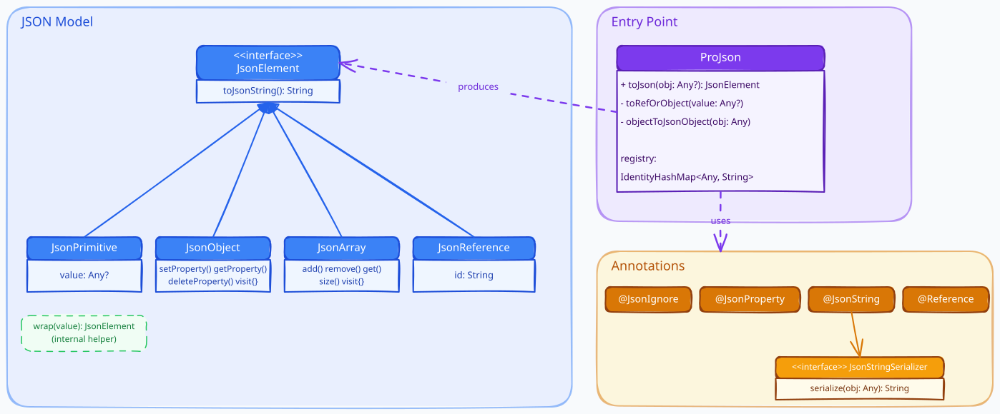

# ProJson

ProJson is a JSON library for Kotlin with no external dependencies (JUnit 5 is used only
for the tests). It has two parts:

- an in-memory model, where a JSON document is a tree of `JsonElement` nodes;
- a serializer, `ProJson`, that turns a Kotlin object into that tree using reflection.

Call `toJsonString()` on any node to get the JSON text. This document shows each public
call and the exact text it produces.

## Building and running

The project uses the Gradle wrapper, so no local Gradle install is needed.

```
./gradlew build     # compile and run the tests
./gradlew test      # run the tests only
./gradlew jar       # build the library JAR into build/libs
```

## Building a document by hand

`JsonObject` holds keys in the order you insert them. `setProperty` adds or overwrites a
key, `getProperty` returns a node or `null`, `deleteProperty` removes a key, and `visit`
walks each entry.

```kotlin
val obj = JsonObject()
obj.setProperty("name", "Alice")
obj.setProperty("age", 30)
obj.getProperty("name")        // JsonPrimitive("Alice")
obj.deleteProperty("age")
println(obj.toJsonString())    // {"name": "Alice"}
```

`JsonArray` holds an ordered list. It has `add`, `remove(index)`, `get(index)`, `size`,
and `visit`.

```kotlin
val arr = JsonArray()
arr.add("a")
arr.add(null)
arr.add(true)
println(arr.toJsonString())    // ["a", null, true]
println(arr.size())            // 3
arr.remove(1)
println(arr.toJsonString())    // ["a", true]
```

`setProperty` and `add` accept `null`, a `String`, a `Number`, a `Boolean`, or an
existing `JsonElement`. Passing any other type throws `IllegalArgumentException`, so a
half-built document cannot hold a value that has no JSON form. `JsonPrimitive` escapes
quotes, backslashes, and control characters when it prints.

## Generating JSON from an object

`ProJson().toJson(value)` returns a `JsonElement`. The shape depends on the value:

- a `String`, `Number`, `Boolean`, or `null` becomes a `JsonPrimitive`;
- a `Map` becomes a `JsonObject` with no `$type`;
- a `Collection` or array becomes a `JsonArray`;
- any other object becomes a `JsonObject` built from its declared fields.

```kotlin
val m = mapOf("x" to 1, "y" to 2)
println(ProJson().toJson(m).toJsonString())   // {"x": 1, "y": 2}

val list = listOf("a", null, "b")
val arr = ProJson().toJson(list) as JsonArray
arr.add("c")
println(arr.toJsonString())                   // ["a", null, "b", "c"]
```

For a plain object, ProJson writes a `$type` field with the class name. A regular class
also gets a `$id` field holding a generated UUID; a data class does not, because a data
class stands for a value. ProJson tells them apart by looking for the `copy` method that
the Kotlin compiler generates only for data classes.

```kotlin
data class Date(val day: Int, val month: Int, val year: Int)
class Task(val description: String, val deadline: Date?, val dependencies: List<Task>)

val t1 = Task("T1", Date(1, 1, 2026), emptyList())
println(ProJson().toJson(t1).toJsonString())
```

```json
{"$id": "341227df-04f0-4252-9375-e00256ed3e27", "$type": "Task", "description": "T1", "deadline": {"$type": "Date", "day": 1, "month": 1, "year": 2026}, "dependencies": []}
```

`Task` is a regular class and gets a `$id`; `Date` is a data class and gets only a
`$type`. The `$id` is a fresh UUID each run, so its value changes between runs.

## Changing the output with annotations

`@JsonProperty("key")` renames a field in the output. `@JsonIgnore` leaves a field out.

```kotlin
class Task(
    @JsonProperty("desc") val description: String,
    @JsonIgnore val deadline: Date?,
    @JsonProperty("deps") val dependencies: List<Task>
)

val t = Task("T1", Date(30, 2, 2026), emptyList())
println(ProJson().toJson(t).toJsonString())
```

```json
{"$id": "…", "$type": "Task", "desc": "T1", "deps": []}
```

`description` prints as `desc`, `dependencies` prints as `deps`, and `deadline` is gone.

`@JsonString` serializes a whole class to one string. Put it on the class and point it at
a `JsonStringSerializer` that has a no-argument constructor.

```kotlin
class DateAsText : JsonStringSerializer {
    override fun serialize(obj: Any): String {
        val d = obj as Date
        return "%02d/%02d/%04d".format(d.day, d.month, d.year)
    }
}

@JsonString(DateAsText::class)
data class Date(val day: Int, val month: Int, val year: Int)

val json = ProJson().toJson(listOf(Date(30, 2, 2026), Date(31, 4, 2026)))
println(json.toJsonString())
```

```json
["30/02/2026", "31/04/2026"]
```

Each `Date` is now a string, so there is no `$type` and no nested object.

## References between objects

A graph where objects point at each other cannot be written as a plain tree without
repeating data. Mark a field with `@Reference` and ProJson writes the target as
`{"$ref": "<id>"}`, pointing at the `$id` the target already received.

```kotlin
class Task(
    val description: String,
    val deadline: Date?,
    @Reference val dependencies: List<Task>
)

val t1 = Task("T1", Date(30, 2, 2026), emptyList())
val t2 = Task("T2", Date(31, 4, 2026), emptyList())
val t3 = Task("T3", null, listOf(t1, t2))
println(ProJson().toJson(listOf(t1, t2, t3)).toJsonString())
```

`t1` and `t2` are written in full because they appear first in the list. Inside `t3`, the
two dependencies are written as references to the ids that `t1` and `t2` already got:

```json
[…, {"$id": "<id-of-t3>", "$type": "Task", "description": "T3", "deadline": null, "dependencies": [{"$ref": "<id-of-t1>"}, {"$ref": "<id-of-t2>"}]}]
```

If two objects reference each other, the first one written goes into the registry before
its fields are processed, so the second one writes a `$ref` back to it instead of
recursing. A cycle therefore prints once and stops.

## Reading the text

Every node implements `toJsonString()`, and `toString()` returns the same text. The output
is valid JSON on a single line; pretty-printing is not applied.

## Architecture



`JsonElement` is the shared interface. `JsonPrimitive`, `JsonObject`, `JsonArray`, and
`JsonReference` implement it. `ProJson` reads a Kotlin object and produces those nodes,
and the annotations (`@JsonIgnore`, `@JsonProperty`, `@JsonString`, `@Reference`) change
what it produces.

## Where each feature lives

- Model nodes: `JsonElement.kt`, `JsonObject.kt`, `JsonArray.kt`, `JsonReference.kt`.
- Reflection, `$type`/`$id`, and data-class handling: `ProJson.kt`.
- Annotations and the `JsonStringSerializer` interface: `Annotations.kt`.
- References (`@Reference`, `$ref`): `ProJson.kt` with `JsonReference.kt`.

Tests for each of these are under `src/test/kotlin/projson`.
